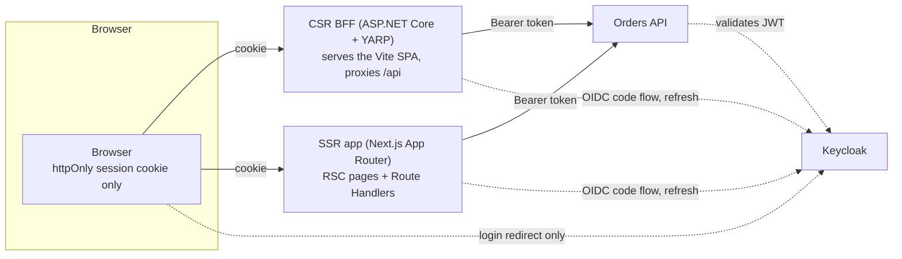
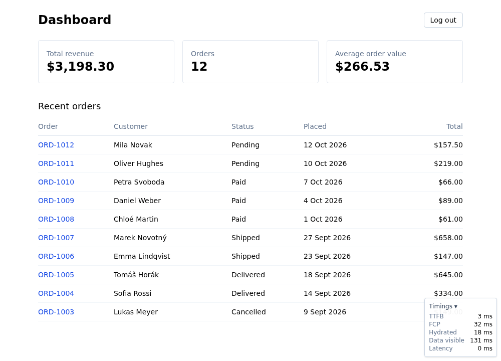
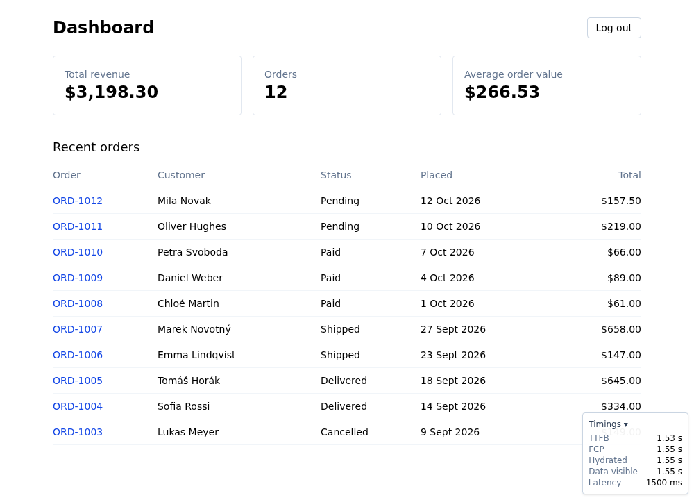

# SSR vs CSR reference

The same pages built twice, once with Client-Side Rendering and once with Server-Side Rendering, to compare what each costs and buys in **Initial Load**: the time from navigating to the app's URL until the first page shows its data. A timing overlay in both apps shows TTFB, FCP, hydration and the moment the data is visible, and `?latency=ms` makes the API slow on demand.

SEO is explicitly out of scope. Terms are defined in [`CONTEXT.md`](CONTEXT.md), decisions in [`docs/adr/`](docs/adr/).

## Layout

| Path | What |
| --- | --- |
| `apps/csr` | CSR app: Vite + React SPA |
| `apps/ssr` | SSR app: Next.js App Router |
| `packages/ui` | Shared UI components used by both apps |
| `services/bff` | ASP.NET Core BFF for the CSR app |
| `services/api` | Orders API: ASP.NET Core minimal API (.NET 10) |
| `keycloak` | Keycloak realm imported on startup |

It's a pnpm workspace (`apps/*`, `packages/*`); the .NET services sit alongside it.

## Run it

```sh
docker compose up --build
```

This starts:

- Keycloak on http://localhost:8080 (admin console: `admin` / `admin`) with the `ssr` realm, the `csr-bff` and `ssr-app` clients and the test user `alice` / `alice`
- The API on http://localhost:5100
- The CSR app (ASP.NET BFF + Vite SPA) on http://localhost:5200
- The SSR app (Next.js App Router, production build) on http://localhost:3000

Log in with the test user `alice` / `alice`. Open either app with `?latency=1500` (for example http://localhost:3000/?latency=1500) to make the API wait 1500 ms before answering.

## Local development

```sh
pnpm install
pnpm --filter @ssr/csr dev      # Vite dev server for the CSR app
pnpm --filter @ssr/ssr dev      # Next.js dev server on :3000
pnpm --filter @ssr/csr test     # also: @ssr/ssr, @ssr/ui; add typecheck for tsc
cd services/api && dotnet run --project src/Orders.Api
cd services/bff && dotnet run --project src/Orders.Bff
```

The apps need Keycloak and the API, so the simplest setup is `docker compose up --build keycloak api` and running the app you are working on locally. Timings from dev servers are not representative; compare production builds.

## Architecture



Each app owns its tokens on the server and gives the browser only an httpOnly session cookie, so **no tokens ever reach the browser's JavaScript**. Keycloak is visited by the browser only to type the password; the code exchange and refresh happen server-side.

- **[ADR-0001](docs/adr/0001-csr-app-also-uses-a-bff.md): the CSR app also has a BFF.** If the CSR app kept tokens in browser storage and the SSR app didn't, the comparison would mix up rendering and token handling and suggest SSR is what makes a BFF possible. Both use one, so only the rendering mode varies.
- **[ADR-0002](docs/adr/0002-ssr-means-nextjs-app-router.md): App Router is RSC + SSR, not classic SSR.** The SSR pages are React Server Components that are server-rendered, and only small client components (such as the timing overlay and links) are hydrated. The comparison is therefore "CSR vs RSC + SSR": less JavaScript is hydrated than in classic SSR, so the hydration cost shown here is a lower bound for it.

## The comparison

Dashboard Initial Load, production builds, 0 ms and 1500 ms of Simulated Latency. Screenshots are captured with Playwright (`pnpm --filter @ssr/e2e screenshots`) against the running stack.

| | CSR, 0 ms | SSR, 0 ms | CSR, 1500 ms | SSR, 1500 ms |
| --- | --- | --- | --- | --- |
| |  |  |  |  |

| Event | CSR 0 ms | SSR 0 ms | CSR 1500 ms | SSR 1500 ms |
| --- | --- | --- | --- | --- |
| TTFB | 3 ms | 23 ms | 2 ms | 1.53 s |
| FCP | 32 ms | 36 ms | 28 ms | 1.55 s |
| Hydrated | 18 ms | 36 ms | 8 ms | 1.55 s |
| Data visible | 131 ms | 34 ms | 1.54 s | 1.55 s |

One run each on a laptop-class machine with everything on localhost, so read the shape, not the digits.

## What this shows

- **SSR has the slower TTFB, but its data arrives earlier.** The server waits for the API before sending any HTML, so with 1500 ms of latency the first byte takes 1.53 s. But when it arrives the data is already in it: data visible follows FCP immediately. At 0 ms the data shows after 34 ms, against 131 ms for CSR, which first has to download and run the bundle and then make a request.
- **CSR has the faster shell, but it is only a shell.** TTFB and FCP stay in the tens of milliseconds whatever the latency, because the static shell doesn't wait for the API. The user sees the page chrome early and then waits for the data: at 1500 ms it shows at 1.54 s, about as late as SSR. A shell is better than a blank page, but it isn't the data. Where API latency is low, CSR's extra round trip is what costs it; where it is high, the two converge, because the API wait dominates either way.
- **Hydration has a cost that this local setup understates.** SSR's page is visible before it is interactive. Here the gap between FCP and "Hydrated" is negligible because the machine is fast, the network is local and, per ADR-0002, RSC hydrates very little. On a slow phone, or with classic SSR hydrating every component, the gap would be larger. CSR pays a similar bill in a different place: its bundle must run before anything is drawn from data.
- **After the first load, the two behave alike.** Both apps navigate client-side (`Link` in Next.js, the router in the SPA), so opening an Order doesn't reload the page. The SSR app still asks the server for each new page's data, while the SPA fetches JSON from the same BFF. The Initial Load differences discussed above only apply to the first page.

## Not covered (yet)

- A CSR app that stores tokens in the browser, as a separate and explicitly labelled variant (see ADR-0001).
- A server-side session store: both BFFs keep the session in an encrypted cookie.
- SSG and incremental static regeneration, which would take the per-request server render out of the picture.
- Deployment: CDNs, edge rendering and real network conditions.

## Get a token and curl the API

The `dev-cli` client allows the password grant, for local use only:

```sh
TOKEN=$(curl -s http://localhost:8080/realms/ssr/protocol/openid-connect/token \
  -d grant_type=password -d client_id=dev-cli -d username=alice -d password=alice \
  | jq -r .access_token)

curl -H "Authorization: Bearer $TOKEN" http://localhost:5100/orders/recent
```

Without the header the API returns `401`. Tokens last 5 minutes.

## Tests

```sh
pnpm -r --filter '!@ssr/e2e' test    # Vitest: ui, csr, ssr
cd services/api && dotnet test       # Orders API
cd services/bff && dotnet test       # CSR BFF, including token refresh
```

The Playwright smoke tests are described [below](#smoke-tests). To watch them, run `pnpm --filter @ssr/e2e exec playwright test --ui`.

### Manual checks

With the stack running, log in as `alice` / `alice` on both apps (http://localhost:5200 and http://localhost:3000):

| Check | Expected |
| --- | --- |
| Open the Dashboard | Recent Orders and the revenue summary (total revenue, Orders, average order value) |
| Open an Order, then try its URL while logged out | Line Items shown; after login you land back on that Order |
| Add `?latency=1500` | API calls wait 1500 ms; the parameter survives login and navigation to an Order |
| Read the timing overlay at 0 and 1500 ms | CSR: TTFB in tens of ms, data visible after the API answers. SSR: TTFB takes the whole latency, data visible right after FCP |
| Reload more than 5 minutes after logging in | Still logged in with no redirect to Keycloak, because each BFF refreshes the token server-side |

## Smoke tests

Playwright smoke tests log in as `alice`, read the Dashboard, open an Order and log out, once per app. They run in CI against the compose stack and don't check timings.

```sh
docker compose up --build --wait
pnpm --filter @ssr/e2e exec playwright install chromium
pnpm --filter @ssr/e2e test
```
